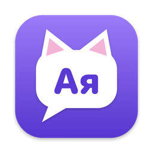
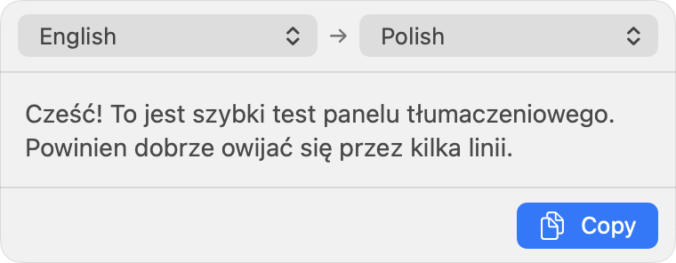

<p align="center">
  
</p>

<h1 align="center">Purrlate</h1>

<p align="center">
  A tiny macOS menu-bar translator. Press <kbd>⌘C</kbd> twice — get a translation next to your cursor.<br>
  Runs fully on-device with Apple's Translation framework. No accounts, no API keys, no dependencies.
</p>

<p align="center">
  
</p>

## Features

- **Double ⌘C to translate.** Copy text twice quickly in any app and a small icon appears near the cursor. Nothing is translated until you click it.
- **Smart default direction.** The source language is detected automatically; text is translated to Polish, and Polish is translated to Russian.
- **Pick any language.** Fix a wrongly detected source language or choose another target right in the panel. The last chosen target is remembered.
- **Stays out of the way.** Menu-bar only (no Dock icon); the panel doesn't steal focus and closes with <kbd>Esc</kbd> or a click outside.
- **Private.** Translation happens on your Mac using downloaded Apple language models — text never leaves the device.
- **Localized UI.** English, Russian and Polish, following the system language.

## Requirements

- macOS 27 or later
- Xcode 27 (or just the Command Line Tools — see below)

## Build & run

```bash
./build.sh
open build/Purrlate.app
```

`build.sh` uses `xcodebuild` when Xcode is installed and falls back to `swiftc` from the Command Line Tools otherwise. You can also open `Purrlate.xcodeproj` in Xcode and press <kbd>⌘R</kbd>.

To install, copy `build/Purrlate.app` to `/Applications`.

## Usage

1. Select text in any app and press <kbd>⌘C</kbd> twice within 0.4 s.
2. Click the icon that appears next to the cursor.
3. Read the translation, change languages if needed, and press **Copy** (or <kbd>Return</kbd>).

Use the menu-bar icon to turn Purrlate on or off, or to quit.

### Language models

Translation needs the language models for the chosen pair. If a model isn't downloaded yet, Purrlate tells you so — download it in **System Settings → General → Language & Region → Translation Languages**.

## How it works

| Piece | Implementation |
| --- | --- |
| Double ⌘C | `NSPasteboard.general.changeCount` polled every 120 ms; two changes within 400 ms trigger the icon |
| Language detection | `NLLanguageRecognizer` |
| Translation | `TranslationSession(installedSource:target:)`, sessions cached per language pair |
| Model check | `LanguageAvailability.status(from:to:)` |
| UI | SwiftUI `MenuBarExtra` + a borderless `NSPanel` (`.nonactivatingPanel`) hosting SwiftUI |

The whole app is a single file: [`Purrlate/PurrlateApp.swift`](Purrlate/PurrlateApp.swift).

## Project layout

```
Purrlate/
  PurrlateApp.swift        app code
  AppIcon.icns             app icon
  {en,ru,pl}.lproj/        UI strings
Purrlate.xcodeproj/        Xcode project
Info.plist                 LSUIElement (no Dock icon), icon, bundle info
build.sh                   build with xcodebuild or swiftc
tools/make-icon.swift      generates AppIcon.icns — run `swift tools/make-icon.swift`
```

## Adding a UI language

Copy `Purrlate/en.lproj` to `Purrlate/<code>.lproj`, translate the values in `Localizable.strings`, and rebuild.

## License

[MIT](LICENSE)
